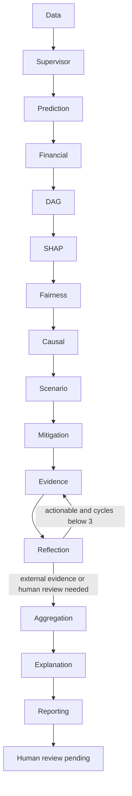

# Agent design

Fourteen specialists plus a supervisor are executable LangGraph nodes. Shared state contains borrower inputs, dataset/model references, assumption acknowledgements, outputs, execution logs and reflection count. Each node calls deterministic tools, stores its result as an evidence snapshot, records duration, and catches failures as explicit error outputs. Downstream reports preserve missing analyses; they do not invent replacements.

Data validates schema; prediction executes calibrated inference; financial computes ratios; DAG validates hypotheses; explainability runs SHAP; fairness computes holdout disparities only with authorization; causal inference withholds estimates when assumptions are not acknowledged; scenario changes mutable conditions; mitigation ranks supportive alternatives; evidence verifies lineage and SHAP additivity and records failed agents; reflection critiques claim scope and balance; aggregation preserves distinct dimensions; explanation composes original evidence; reporting produces the final structured output.

The supervisor emits a dependency plan and an assumption-based causal route. Execution is sequential in this milestone. LangGraph's in-memory checkpoints support the current invocation; persisted analytical snapshots retain outputs after process exit but do not resume a crashed graph. Reflection is bounded at three and currently exits after one cycle because unresolved issues require external evidence. No claim of autonomous scientific validation or LLM deliberation is made. Retry, parallel execution, cancellation, hard timeouts and asynchronous status polling remain future work.
