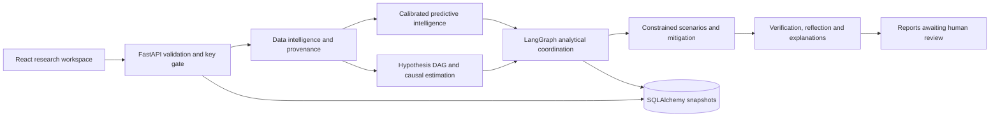

# Architecture

The hosted synthetic demo now uses Vercel Services: React and FastAPI share the deployment domain, and `/api/*` routes to Python. Private Blob objects persist datasets, trained artifacts and immutable snapshots; signed HttpOnly account cookies provide workspace isolation. Account-linked initialization automatically creates/reuses the starter benchmark and four models; the login/create-account UI gates the dashboard until preparation is complete. Local mode retains the SQLAlchemy repository described below. See `vercel-deployment.md` and `cloud-validation.json` for the tested hosted architecture and its limits.

Six conceptual layers are implemented as small reusable modules, rather than empty files for every proposed class. Dataset CSVs and trusted model artifacts live in `runtime`; append-only application snapshots store provenance, model metrics, graphs, agent outputs, reports and request audits. Parent foreign keys preserve version lineage. SQLite has foreign-key checks enabled. PostgreSQL uses the same SQLAlchemy model but has not been exercised here.

The compact snapshot schema intentionally differs from the master prompt's 30-table production design. There is no database-level append-only enforcement: a database administrator can change rows. Checksums detect dataset file changes during analytical reads but are not cryptographic audit signatures.

The UI has Overview, Data workspace, Borrower analysis, Causal laboratory, Scenario studio, Fairness audit, Agent execution, and Evidence & reports. These merge several of the requested 14 pages; they consume real backend outputs. API keys stay in memory. No paid API is involved.
