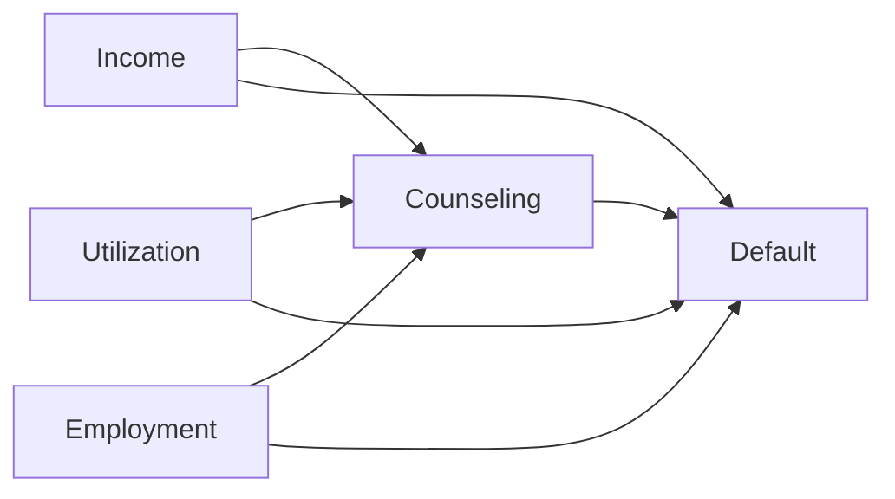
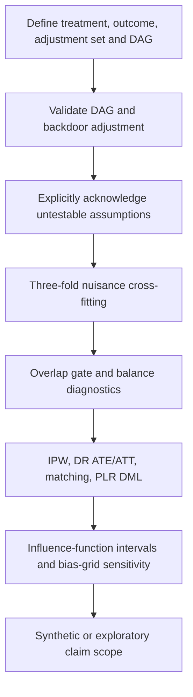

# Causal methodology

The benchmark simulates baseline annual income I, utilization U, and employment E. Counseling assignment has propensity `sigmoid(-0.2 + 0.8 U - 0.000008 I - 0.03 E)`. Untreated default probability is `p0 = sigmoid(-1 + 2 U - 0.000012 I - 0.04 E)`; treated probability is `p1 = clip(p0 - 0.08, 0.001, 0.999)`. Outcomes are Bernoulli draws under assigned treatment. The known sample-population ATE is the mean of `p1 - p0`; ATT is its mean over assigned treated. Seeds, sample sizes and target definitions accompany provenance. Credit and loan variables outside this outcome DGP are intentionally irrelevant noise or dependent financial features.

The graph is a domain hypothesis outside synthetic simulation. Graph validation checks acyclicity and declared nodes. Backdoor validation removes treatment-outgoing edges and checks d-separation given the supplied adjustment set; descendants of treatment are forbidden. Researchers must still justify the graph, measurement timing, population selection, consistency, positivity, no interference and conditional exchangeability. Checkbox acknowledgement does not demonstrate these conditions.

IPW uses the Horvitz–Thompson contrast `T Y/e - (1-T)Y/(1-e)`. AIPW uses `m1-m0 + T(Y-m1)/e - (1-T)(Y-m0)/(1-e)`. DR ATT normalizes the treated residual contrast by treatment prevalence; its influence accounts for the estimated denominator. Propensity and outcome logistic nuisances use cross-fitted predictions. This does not guarantee correct specification or remove unmeasured confounding.

PLR DML residualizes treatment and outcome and estimates `mean((T-e)(Y-m))/mean((T-e)^2)`. Its general estimand is an overlap-weighted partially linear projection, not necessarily ATE under heterogeneous effects. Matching is one nearest control with replacement on propensity log-odds, with a 0.2-standard-deviation caliper; it estimates ATT for matched treated and has no reported naive CI because reused controls induce dependence. Matching uses cross-fit estimated propensities but is not itself an orthogonal cross-fit estimator.

The positivity gate withholds all effects when fewer than 90% of estimated propensities fall between .05 and .95. Estimation clips propensities to [.025,.975] and reports the clipped fraction, raw range, combined and arm-specific ESS. Balance reports standardized mean differences before/after weighting; absolute weighted SMD below .1 is an illustrative screen. Passing diagnostics never establishes exchangeability. The sensitivity grid subtracts assumed additive biases; it is not a formal hidden-confounding robustness analysis.

Intervals use asymptotic score/influence calculations. The IPW score interval treats estimated propensities as fixed and does not fully account for nuisance estimation; it should be interpreted as approximate. AIPW/PLR orthogonal scores still require nuisance-rate and regularity conditions. Repeated cross-fitting, bootstrap specification checks, discovery, CATE forests, DoWhy/EconML integration, DiD and instruments are pending. Real observational results are always exploratory. No individual causal effect is claimed.

References: [DoWhy identification](https://www.pywhy.org/dowhy/v0.9.1/user_guide/effect_inference/identify.html), [DoWhy paper](https://arxiv.org/abs/2011.04216).
