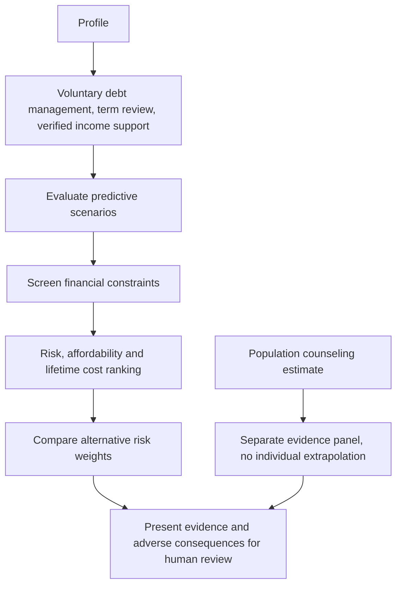

# Mitigation methodology

The rank is `0.5 * predicted_probability_reduction + 0.3 * PTI_improvement - 0.2 * positive_repayment_cost_change/annual_income`, with feasible options first. Weight sensitivity compares risk weights .25/.5/.75 while retaining the cost penalty. Units and weights are transparent design choices, not an empirically optimized welfare objective. Ranking is not execution or proof of benefit.

Term extension includes lifetime interest cost. Debt reduction requires resources and may incur fees; income support requires actual eligibility. None is assumed achievable. Population counseling evidence, when available with matching dataset lineage, remains a separate ATE with diagnostics and claim scope. It is not evidence for the three different modeled interventions. No default denial or pricing increase recommendation is generated. Real intervention data and operational review are necessary before policies can be evaluated causally.
